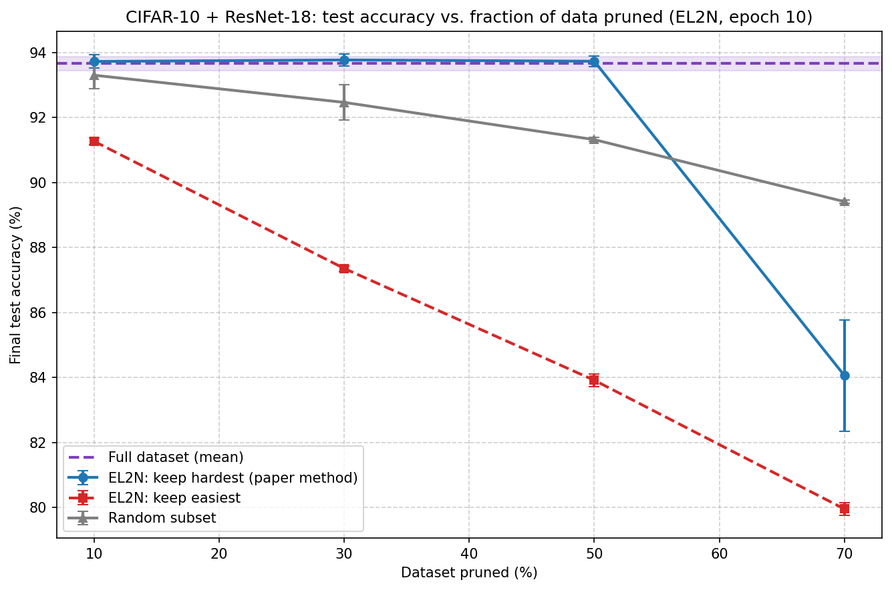
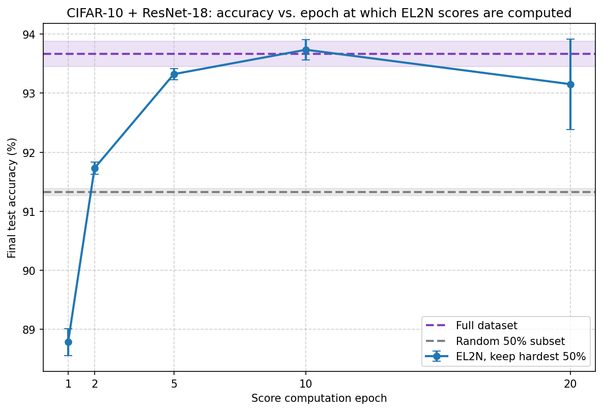
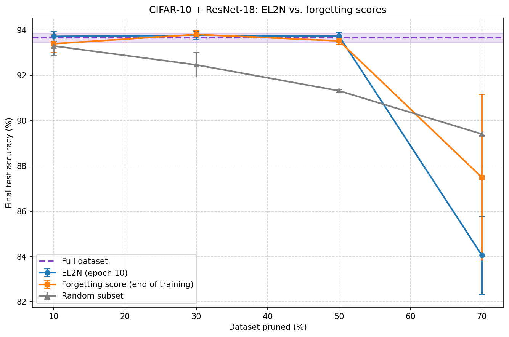
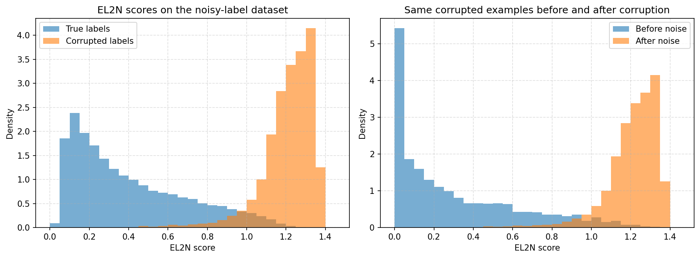
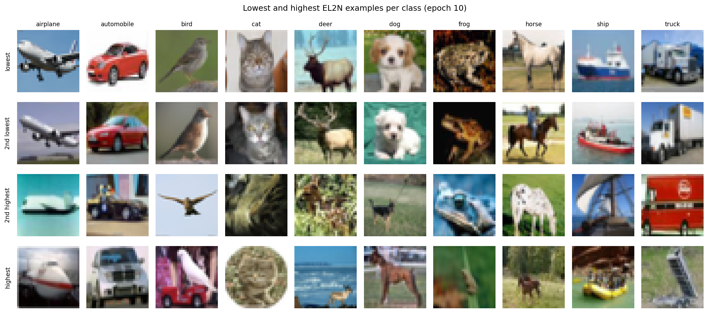
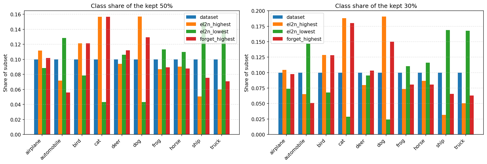

# Отчёт о воспроизведении статьи Deep Learning on a Data Diet: Finding Important Examples Early in Training
# Автор: Чебыкины Артём

**Авторы оригинальной статьи (текст приведен в репозитории):** M. Paul, S. Ganguli, G. K. Dziugaite

**Воспроизводим:** метод отбора обучающих примеров по метрике EL2N, вычисленной на ранних эпохах обучения, и проверку на задаче сокращения обучающей выборки.

Работа выполнена на датасете CIFAR-10 с ResNet-18 на одной видеокарте NVIDIA GeForce RTX 3070 Ti.

---

## 1. Как воспроизвести ноутбук

### 1.1. Окружение

Эксперименты выполнены в следующем окружении (`run_config.json`):

| Компонент | Версия |
|---|---|
| Python | 3.10.19 |
| PyTorch | 2.7.1+cu118 |
| torchvision | 0.22.1+cu118 |
| GPU | NVIDIA GeForce RTX 3070 Ti |

Версии остальных библиотек (numpy, pandas, matplotlib, tqdm, jupyter, ipywidgets) не фиксировались, использовались актуальные на момент запуска.

Нужна видеокарта NVIDIA с поддержкой CUDA: ноутбук рассчитан на GPU.

На CPU не запускался!

### 1.2. Время работы

Один прогон дообучения на RTX 3070 Ti занимал по логам в среднем около 9 минут.

Полный ноутбук выполнялся порядка 13-14 часов.

### 1.3. Сохранение промежуточных результатов

- После каждого завершённого прогона результат записывается в чекпоинт-файл. При прерывании, достаточно просто выполнить ноутбук сверху вниз: завершённые прогоны загружаются из чекпоинтов и пропускаются, работа продолжается с первого незавершённого.
- Каждый чекпоинт хранит параметры, с которыми был создан. При несовпадении параметров ячейка падает с сообщением об ошибке, чтобы не смешивать несопоставимые результаты. В этом случае старые чекпоинты нужно удалить из папки.
- Для воспроизводимости фиксируются все сиды, включён `cudnn.deterministic`. На том же хард-окружении результаты воспроизводятся

### 1.4. Ожидаемые артефакты

- **Таблицы (CSV)**
  - `step2_summary.csv` а средняя точность и стандартное отклонение по стратегиям (EL2N-hardest, EL2N-easiest, random) для каждой доли данных.
  - `step3_epoch_ablation.csv` - точность при 50 % данных для EL2N оценок по первым эпохам вместе со значениями для полной выборки и случайных 50 %.
  - `step5_el2n_vs_forgetting.csv` - сравнение EL2N, forgetting и случайного отбора
  - `step7_epoch_rank_correlation.csv` - матрица ранговых корреляций Спирмена между EL2N-оценками разных эпох.
  - `step7_class_composition.csv` - доли классов в подвыборках (весь датасет, EL2N-hardest, EL2N-easiest, forgetting-hardest).
  - `all_runs.csv` - результаты всех отдельных прогонов дообучения
  - `paired_differences.csv` - попарные разности точности по сидам между методами и относительно полной выборки.
- **Графики (PNG)**
  - `step2_pruning_curve.png` - точность в зависимости от доли отброшенных данных
  - `step3_epoch_ablation.png` - точность при 50 % данных в зависимости от эпохи вычисления EL2N.
  - `step5_el2n_vs_forgetting.png` - сравнение EL2N, forgetting и случайного отбора по уровням прунинга.
  - `step6_noise_score_histograms.png` - распределения EL2N для примеров с исходными и испорченными метками.
  - `step7_example_images.png` - примеры с наименьшими и наибольшими EL2N по классам.
  - `step7_class_composition.png` - состав классов в подвыборках 50 % и 30 %.
- **Описание запуска**
  - `run_config.json` - версии библиотек, GPU, параметры эксперимента, сиды и несколько констант для данных.

Изобржения в данном отчёте подтягиваются из папки `figures/` под теми же именами, которые создаёт ноутбук.

---

## 2. Что воспроизводим

### 2.1. Постановка

Статья предлагает оценивать важность обучающего примера нормой вектора ошибки EL2N, усреднённой по нескольким независимым сидам обучения, и показывает, что такая оценка, вычисленная через несколько эпох, позволяет отбросить значительную долю данных без потери точности.

Воспроизводится эта линия экспериментов.

**Датасет:** CIFAR-10.

**Модель:** ResNet-18 в низкоразрешающем варианте (первая свёртка 3×3 со страйдом 1, max-pooling убран), как в Приложении B.2 статьи.

### 2.2. Дополнительные комментарии и ограничения

- **Только CIFAR-10 + ResNet-18.** Это основная постановка статьи, она же самая дешёвая по ресурсам из рассмотренных в статье. Остальные постановки (CIFAR-100 + ResNet-50, CINIC-10) требуют значительно больше вычислений. При этом логика работы может быть проверена и на таком подмножестве данных
- **Только EL2N, без GraNd.** В статье после раздела 3 основной акцент сделан на EL2N: авторы пишут, что сосредоточены на EL2N-оценках, вычисленных рано в обучении, так как они точнее выявляют важные примеры.
- **Ограничения, которые мы учитывали.** Статья сообщает, что весь проект потребовал около 15 000 GPU-часов. С учётом ограниченности ГПУ ресурсов, была сохранена логика и главные утверждения статьи, при этом была сокращена длина обучения, число сидов и некоторые другие параметры.

---

## 3. Что не воспроизводим

- **GraNd-оценка**  и все эксперименты с ней. Данная оценка более затратна по вычислениям, и не является такой же надежной как EL2N.
- **Другие наборы данных и модели** 
- **Скользящее окно из раздела 4** - обучение на подвыборках с отбрасыванием самых высоких оценок
- **Раздел 5 оригинальной статьи** - скорость эволюции NTK и линейная связность мод.
- **Приложения D, E, G**
- **Forgetting-оценки на разных эпохах** - вычисление не только в конце обучения.

---

## 4. Допущения и изменения

### 4.1. Изменения относительно статьи

- **Длина дообучения:** 50 эпох вместо 200 эпох. Процесс снижение LR в 5 раз на 30 %, 60 % и 80 % шагов (аналог эпох 60, 120, 160).
- **Число сидов:** 3вместо 4
- **Прунинг данных:** 0 / 10 / 30 / 50 / 70 % - шаг больше, чем в статье.
- **Forgetting-оценки:** считаются на  50 эпохах (в статье - 200)
- **Шаг 3 (абляция по эпохе):** только EL2N, эпохи 1 / 2 / 5 / 10 / 20, только 50 % данных

### 4.2. Дополнительные идеи (нет в статье):

- Контроль «оставить самые лёгкие» (`el2n_lowest`).
- Матрица ранговых корреляций между эпохами и состав классов в подвыборках.
- Попарные разности по сидам

---
## 5. Выполненная проверка

### Шаг 1. Computing Early EL2N Scores

**Что сделано.** Десять независимых обучений ResNet-18 на 20 эпох; после эпох 1, 2, 5, 10 и 20 для каждого обучающего примера считается EL2N, затем значения усредняются по десяти запускам. Оценки всех пяти эпох сохраняются.

**Результат.** Получены усреднённые оценки для всех эпох. С ростом эпохи оценки в целом уменьшаются: модель всё лучше подгоняет обучающие данные.

Данные оценки используются во всех последующих шагах.

### Шаг 2. Data Pruning and Retraining

**Что сделано.** Для долей 90 %, 70 %, 50 %, 30 % оставляем: примеры с самыми высокими EL2N (метод статьи), с самыми низкими EL2N (контроль) и случайные. Модель обучается заново с нуля при фиксированном числе шагов, по 3 сида на каждую точку. Дополнительно обучается модель на полной выборке.

**Результат.** При умеренном прунинге модель, обученная на примерах с высоким EL2N, достигает точности полной выборки, и по мере роста прунинга (до половины данных) всё заметнее превосходит случайный отбор. Выбор самых лёгких примеров хуже случайного на всех уровнях. При самом сильном прунинге качество EL2N-подвыборки резко падает ниже случайного и становится нестабильным по сидам, что согласуется с утверждением статьи о резком падении при экстремальном прунинге.

Абсолютная точность ниже, чем в статье.

### Шаг 3. Score Epoch Ablation

**Что сделано.** Фиксируем 50 % данных (примеры с высокими EL2N) и строим подвыборки по оценкам EL2N на 1, 2, 5, 10 и 20 эпохах. Каждую подвыборку обучаем заново (3 сида) и сравниваем с полной выборкой и случайными 50 %.

**Результат.** Оценки самых первых эпох заметно хуже: подвыборка по эпохе 1 хуже случайной, по эпохе 2 лишь немного лучше. Уже через несколько эпох подвыборка даёт точность, близкую к полной выборке. Эпоха 20 в нашем эксперименте не лучше эпохи 10. В целом это подтверждает утверждение статьи, что достаточно EL2N оценок через несколько эпох.

### Шаг 4. Forgetting Score Baseline

**Что сделано.** Обучены 10 сетей на полной выборке, для каждого примера посчитано число переходов «верно → неверно», значения усреднены. Те же уровни прунинга и сиды, что в шаге 2, но отбор по высоким forgetting-оценкам.

**Результат.** При умеренном прунинге EL2N и forgetting дают сопоставимую точность, и по мере роста прунинга (до половины данных) оба заметно превосходят случайный отбор. При самом сильном прунинге качество обоих методов падает в среднем ниже случайного; у forgetting падение в среднем меньше, но с большим разбросом между сидами, но три сида не позволяют уверенно различить два метода. Ранги EL2N и forgetting-оценок сильно согласованы что согласуется с наблюдением статьи о высокой ранговой корреляции этих оценок.

### Шаг 5. Label Noise Analysis

**Что сделано.** У 10 % обучающих примеров метки перемешаны между собой. На зашумлённых данных EL2N считается заново (10 запусков по 10 эпох). Сравниваются оценки примеров с исходными и испорченными метками, оценки одних и тех же примеров до и после порчи, и доля испорченных меток среди примеров с наибольшими оценками.

**Результат.** Распределение оценок испорченных примеров сосредоточено в области высоких значений, а у исходных примеров - преимущественно в области низких. Оценки тех же примеров после порчи метки заметно выше, чем до неё. Среди примеров с наивысшими оценками подавляющее большинство - с испорченными метками. Это согласуется с выводом статьи о том, что EL2N позволяет выявлять примеры с испорченными метками. Влияние такого шума на качество обучения не проверялось.

### Шаг 6. Finalising the results

**Что сделано.** Построены примеры изображений с наименьшими и наибольшими EL2N по классам, матрица ранговых корреляций между оценками разных эпох, состав классов в подвыборках 50 % и 30 % для EL2N-hardest, EL2N-easiest и forgetting-hardest

**Результат (примеры).** Примеры с наименьшей оценкой - типичные, чёткие изображения объекта в характерном ракурсе. Примеры с наибольшей оценкой - необычные ракурсы, нетипичный фон, нечёткие изображения или мелкие объекты, что соответствует описанию в статье.

**Результат (состав классов).** Подвыборки с высокими EL2N (и с высокими forgetting-оценками) смещены в сторону трудных классов, прежде всего "cat" и "dog", и содержат заметно меньше других объектов. Подвыборки с низкими EL2N смещены в противоположную сторону. Это согласуется с гипотезой авторов о потере покрытия данных при сильном прунинге, но прямой проверкой гипотезы не является.

